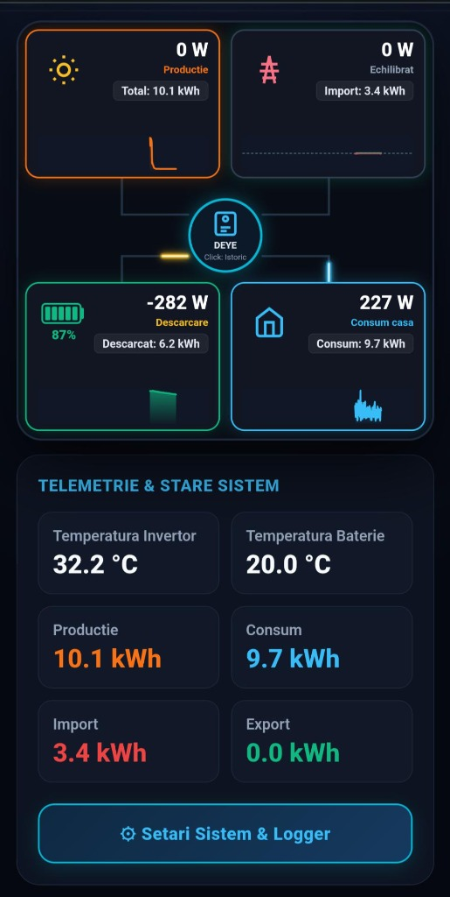
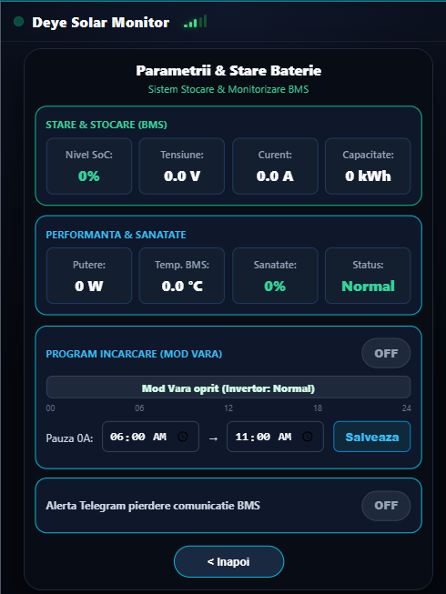
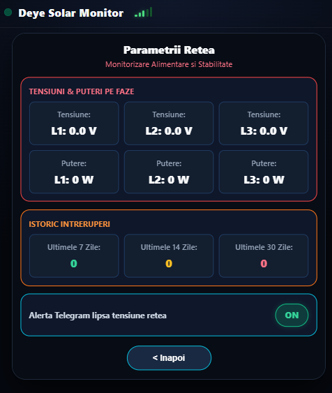
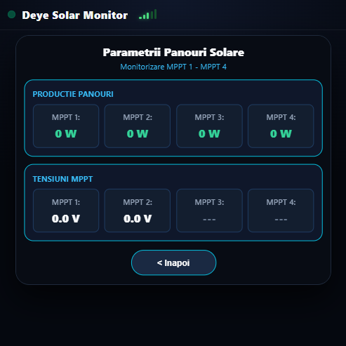
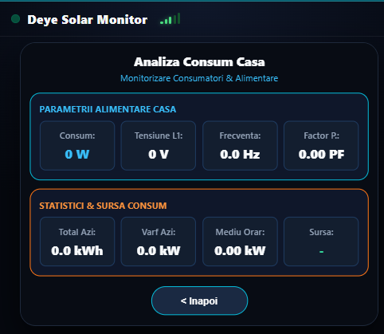
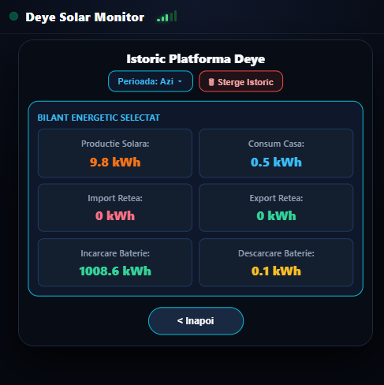
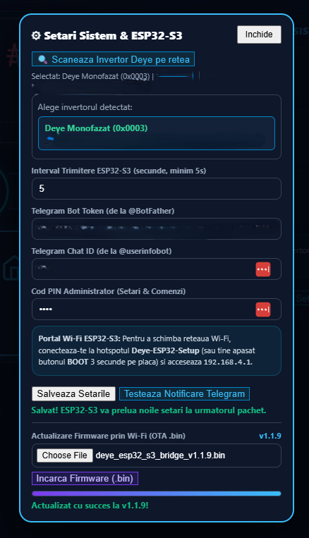

# ⚡ Deye Solar Monitor — Server Web Local pe ESP32-S3 (`http://deye.local/`)

Aplicație complet autonomă de monitorizare în timp real, istoric energetic, control încărcare baterie (**Mod Vară 0 A**) și alerte **Telegram** pentru invertoare **Deye Hibride (Monofazate și Trifazate)**, rulată direct pe o plăcuță **ESP32-S3 DevKitC-1 N16R8** — **fără server extern, fără Raspberry Pi și fără abonament cloud**.



---

## ✨ Funcționalități principale

- **100% Local & Autonom (`http://deye.local/`)**: Serverul web, baza de date de istoric (pe Flash-ul de 16 MB) și grafica animată rulează direct pe ESP32-S3.
- **Universal pentru Invertoare Deye Hibride**:
  - **Auto-detecție în rețea (UDP `48899` + TCP `8899`)** a stick-ului Wi-Fi Solarman (LSW-3 / LSW-5) montat pe invertor.
  - **Recunoaștere automată a tipului de invertor** din registrul `0` (**Deye Monofazat** `1-Phase` sau **Deye Trifazat** `3-Phase`) și memorare permanentă în NVS pentru citirea exactă a registrelor Modbus RTU peste Solarman V5.
- **Dashboard Live & PWA pentru Smartphone / PC**:
  - Diagramă animată în timp real cu fluxurile energetice (**Panouri Fotovoltaice**, **Baterie**, **Rețea**, **Consum Casă**) și mini-grafice pe 24h.
  - Indicator vizual cu 5 trepte pentru puterea semnalului Wi-Fi al plăcii ESP32-S3 (`dBm`) + rând dedicat cu indicatori live **3D SVG** pentru **CPU %**, **RAM %**, **Stocare Flash %** (calculată din memoria Flash reală de 16 MB) și **Temperatura internă a cipului ESP32-S3 (°C)**.
  - **Persistență ecran aprins pe smartphone** (buton **☀️ Ecran activ** în bara de sus cu Screen Wake Lock + fallback automat pentru `http://deye.local/`).
  - Se poate instala ca aplicație nativă pe telefon (**PWA — Add to Home Screen**), cu suport pentru gestul de întoarcere (**swipe de la marginea ecranului**) și **pull-to-refresh (swipe de sus în jos)**.
- **Program Încărcare Baterie — Mod Vară (`0 A`)**:
  - Permite selectarea unui interval orar (ex. `06:00 → 11:00`) în care curentul maxim de încărcare a bateriei este setat automat la **`0 A`** pentru ca bateria să rămână disponibilă să preia vârful de producție solară la orele cu supratensiuni în rețea.
  - La sfârșitul intervalului, restaurează automat curentul normal al invertorului (ex. `60 A` / `100 A`, citit dinamic din registrul invertorului).
  - Scrie în registrul invertorului doar la tranzițiile orare (maximum 2 scrieri/zi) pentru a proteja memoria internă a invertorului.



- **Alerte Telegram cu Butoane `ON/OFF` individuale**:
  - **Alertă Lipsă Tensiune Rețea** (în ecranul *Parametrii Rețea*): trimite notificare pe Telegram la căderea rețelei (`< 50 V`) și la revenirea tensiunii, cu SoC-ul bateriei și consumul casei.
  - **Alertă Pierdere Comunicație BMS Baterie** (în ecranul *Parametrii Baterie*): trimite notificare pe Telegram dacă invertorul pierde comunicația cu BMS-ul bateriei.
  - **Alertă Risc Îngheț Baterie** (în ecranul *Parametrii Baterie*): prag de temperatură reglabil (ex. `8 °C`); trimite alertă pe Telegram la atingerea pragului și la fiecare scădere cu încă `1 °C` (fără alerte la creșterea temperaturii).
  - **Verificare zilnică automată la ora 18:00**: ESP32-S3 verifică automat dacă există o versiune nouă pe GitHub și trimite notificare pe Telegram cu versiunea și noutățile.
- **Istoric Energetic Local (Zi / Lună / An / Total)** salvat în partiția Flash dedicată de pe ESP32-S3.
- **Actualizare Firmware prin Wi-Fi (OTA)**:
  - **Direct de pe GitHub (1-click)**: buton *Verifica Actualizari pe GitHub* în Setări, care verifică automat ultima versiune și instalează firmware-ul direct prin HTTPS.
  - **Manual (`.bin`)**: încărcare fișier `.bin` descărcat din secțiunea **GitHub Releases**, cu rollback automat în caz de eroare.
- **Securizare prin Cod PIN** (configurat la prima instalare în portalul Wi-Fi, cu blocare temporară după 3 încercări greșite).

---

## 📱 Capturi de Ecran din Aplicație

| Parametrii & Stare Baterie | Parametrii Rețea & Alertă |
| :---: | :---: |
|  |  |

| Parametrii Panouri Solare | Analiză Consum Casă |
| :---: | :---: |
|  |  |

| Istoric Platformă Deye | Setări Sistem, Scanare Invertor & OTA |
| :---: | :---: |
|  |  |

---

## 🛠️ Hardware compatibil

| Componentă | Specificație recomandată |
| :--- | :--- |
| **Placă de dezvoltare** | **ESP32-S3 DevKitC-1 N16R8** (**16 MB Flash** + **8 MB Octal PSRAM**) |
| **Logger Invertor** | Stick Wi-Fi **Solarman** (LSW-3 / LSW-5, port local `8899` TCP / `48899` UDP) |
| **Invertoare compatibile** | **Deye Hibrid Monofazat** (ex. `SUN-3.6K/5K/6K/8K-SG03LP1 / SG04LP1 / SG05LP1`) și **Deye Hibrid Trifazat** (ex. `SUN-8K/10K/12K-SG04LP3`) |

---

## 🚀 Instalare și Configurare (Pas cu Pas)

### 1. Scrierea firmware-ului pe ESP32-S3 (prima dată, prin cablu USB)

#### Varianta A — Rapid, cu un singur dublu-click pe **`flash_esp32_s3.bat`** (fără ESP-IDF și fără CMD)

**Ce trebuie să ai instalat pe PC (Windows 10 / 11):**
1. **Python 3** — descărcat gratuit de pe [python.org/downloads](https://www.python.org/downloads/) *(important: la instalare bifează căsuța **"Add python.exe to PATH"**)*.
   - **Nu** trebuie să instalezi manual `esptool` sau `ESP-IDF` — scriptul `flash_esp32_s3.bat` verifică și instalează singur utilitarul `esptool` la prima rulare.
2. **Driverul USB-Serial** *(doar dacă Windows nu recunoaște placa în Device Manager la `Ports (COM & LPT)`)*:
   - Dacă folosești portul **`USB` (Native USB / OTG)** de pe ESP32-S3, Windows 10/11 îl recunoaște automat fără niciun driver.
   - Dacă folosești portul **`UART` / `COM`** de pe placă, Windows instalează de obicei automat driverul **CH343 / CH340** sau **Silicon Labs CP210x** prin Windows Update.

**Pași de încărcare (nu este nevoie să deschizi CMD):**
1. Pe pagina GitHub a proiectului, apasă butonul verde **`<> Code`** → **`Download ZIP`**, apoi **dezarhivează** folderul pe PC (ex. pe Desktop).
2. Conectează placa **ESP32-S3 DevKitC-1 N16R8** la PC printr-un cablu USB de date.
3. Dă **dublu-click direct din Windows Explorer pe fișierul `flash_esp32_s3.bat`**:
   - *(Notă Windows SmartScreen: Pentru că fișierul este descărcat de pe internet, Windows poate afișa la primul dublu-click o fereastră albastră **"Windows protected your PC" / "Windows v-a protejat PC-ul"**. Apasă pe **"More info" / "Mai multe informații"** și apoi pe butonul **"Run anyway" / "Rulați oricum"**).*
   - Se deschide automat fereastra de instalare care detectează Python, instalează `esptool` (dacă nu există deja) și afișează lista porturilor `COM` găsite pe PC.
   - Apasă direct tasta **`Enter`** pentru a folosi portul `COM` detectat automat (sau tastează portul dorit, de ex. `COM7`, și apasă `Enter`).
   - Scriptul scrie automat bootloader-ul (cu `CONFIG_BOOTLOADER_APP_ROLLBACK_ENABLE=y`), tabelul de partiții și firmware-ul `v1.4.8` în **ambele partiții OTA** (`ota_0` la `0x20000` și copia de siguranță `ota_1` la `0x320000` pentru rollback automat):
   ```bash
   python -m esptool --chip esp32s3 -b 460800 write_flash --flash-mode dio --flash-size 16MB ^
     0x0 build/bootloader/bootloader.bin ^
     0x8000 build/partition_table/partition-table.bin ^
     0xf000 build/ota_data_initial.bin ^
     0x20000 build/deye_esp32_s3_bridge.bin ^
     0x320000 build/deye_esp32_s3_bridge.bin
   ```
   - La final, fereastra rămâne deschisă cu mesajul **`[SUCCES] Firmware v1.4.8 incarcat cu succes`** până o închizi de la butonul **Close (`X`)**.

#### Varianta B — Compilare din codul sursă (ESP-IDF v5.x / v6.x)
```bash
idf.py set-target esp32s3
idf.py build
idf.py -p COMx flash
```

---

### 2. Configurarea Wi-Fi și a Codului PIN (Captive Portal)

1. La prima pornire (sau dacă ții apăsat butonul **`BOOT`** de pe placă timp de **3 secunde**), ESP32-S3 creează hotspotul Wi-Fi:
   - **Nume rețea (SSID):** `Deye-ESP32-Setup` (fără parolă)
2. Conectează-te cu telefonul sau laptopul la rețeaua **`Deye-ESP32-Setup`**.
3. Fereastra de configurare se deschide automat (**Captive Portal**) — sau accesează în browser **`http://192.168.4.1`**:
   - Apasă **Scanează Rețele Wi-Fi**, alege rețeaua Wi-Fi a casei (cea la care este conectat și loggerul invertorului) și introdu parola Wi-Fi.
   - Setează un **Cod PIN de Administrator** (opțional, recomandat pentru protejarea setărilor și a comenzilor).
   - Apasă **Salvează & Conectează**.

---

### 3. Accesarea aplicației și detectarea invertorului (`http://deye.local/`)

1. După conectarea la Wi-Fi, deschide în browser (pe telefon sau PC, în aceeași rețea Wi-Fi):
   - **`http://deye.local/`** (sau direct adresa IP primită de ESP32-S3 de la router).
2. Placa **detectează automat** loggerul Solarman din rețea și tipul invertorului (**Monofazat** sau **Trifazat**).
3. Pentru verificare sau schimbare manuală, deschide **⚙ Setari Sistem & Logger**:
   - Apasă **🔍 Scaneaza Invertor Deye pe retea** → selectează invertorul detectat.
   - *(Opțional)* Completează **Telegram Bot Token** (de la `@BotFather`) și **Telegram Chat ID** (de la `@userinfobot`) și apasă **Testeaza Notificare Telegram**.
   - *(Opțional)* Pentru actualizări ulterioare de firmware, încarcă fișierul `.bin` direct în secțiunea **Actualizare Firmware prin Wi-Fi (OTA .bin)**.

---

## 📂 Structura Proiectului

```text
├── main/
│   ├── main.c               # Inițializare sistem, Wi-Fi, SNTP, verificare/rollback OTA
│   ├── app_config.h         # Constante implicite (fără date personale) și versiune firmware
│   ├── app_settings.c/.h    # Salvare persistentă a setărilor în memoria NVS
│   ├── wifi_manager.c/.h    # Gestionare Wi-Fi STA + SoftAP (Deye-ESP32-Setup) + buton BOOT 3s
│   ├── solarman_v5.c/.h     # Protocol Solarman V5 peste TCP 8899 (Modbus 0x03 Read / 0x10 Write)
│   ├── logger_discovery.c/.h# Auto-detecție logger pe LAN (UDP 48899 + scanare rapidă TCP 8899)
│   ├── deye_modbus.c/.h     # Poller universal Deye Monofazat & Trifazat + Mod Vară 0A
│   ├── history_store.c/.h   # Stocare istoric energetic pe Flash + sincronizare oră SNTP România
│   ├── telegram_notify.c/.h # Notificări HTTPS direct către API-ul Telegram (Rețea & BMS)
│   └── local_web_server.c/.h# Server HTTP local, Captive Portal DNS, API JSON și OTA update
├── web/
│   └── index.html           # Interfața web completă (Dashboard SVG, Parametri, Istoric, PWA)
├── docs/                    # Capturi de ecran pentru documentație
├── LICENSE                  # Licență MIT
├── partitions.csv           # Tabelul de partiții pentru Flash 16 MB (Dual OTA + History Storage)
└── CMakeLists.txt           # Configurație build ESP-IDF
```

---

## 📄 Licență

Acest proiect este distribuit sub licența **MIT License** — vezi fișierul [LICENSE](LICENSE) pentru detalii.
Software-ul este oferit „ca atare” (*AS IS*), fără garanții, exclusiv în scop de monitorizare și automatizare locală.
